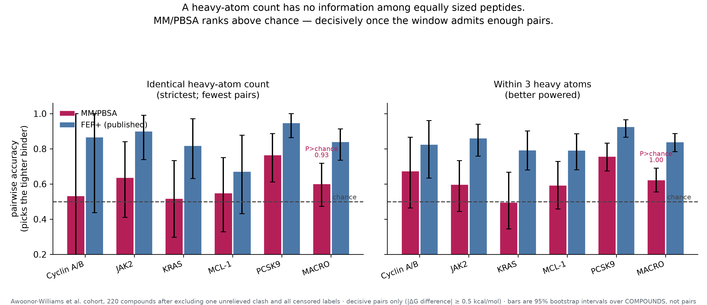

# Size-matched benchmarking of end-point MM/PBSA on macrocyclic peptides

Code and derived results for a replication of the Zhao *et al.* (2025) single-structure
MM/PBSA protocol, evaluated on 234 macrocyclic peptides with measured binding affinities.

## The question

Larger peptides generally bind more tightly, because more atoms bury more interface area.
That is real physics, and it makes most benchmarks easy to pass: a method can look predictive
while only re-reading molecular size. We therefore evaluate **within sets of peptides that
have the same heavy-atom count**, where a size descriptor carries no information at all by
construction, and ask how often a method picks the tighter binder of a pair.

## Headline result

Among peptides of identical heavy-atom count, on decisive pairs (measured affinities
differing by at least 0.5 kcal/mol):

| method | pairwise accuracy | 95% CI |
|---|---:|---|
| MM/PBSA (single minimised structure) | **60.1%** | [53.0, 69.3] |
| FEP+ (published, same compounds) | 84.1% | [75.6, 91.2] |
| heavy-atom count | — | undefined: no size difference to read |

Chance is 50%. The macro interval excludes it, so the skill is real but modest, and it is
concentrated: clearly above chance on PCSK9 (76.5%) and JAK2 (63.7%), with Cyclin A/B, KRAS
and MCL-1 spanning chance.



## What this is not

The score is a ranking device, not a predictor of binding constants. With the entropy term
omitted it sits 45–75 kcal/mol away from experimental ΔG, and the per-target fitted slope is
0.10–0.21, so ΔΔG spread is inflated five- to tenfold. Reported RMSE values are achievable
only after fitting slope and intercept within a target, which requires compounds already
measured in that series.

## Layout

```
manuscript/  full draft manuscript (MANUSCRIPT.md)
scripts/     pipeline (structure prep, parameterisation, scoring) and analysis
results/     computed scores, per-family statistics, bootstrap intervals
figures/     publication figures, 300 dpi
methods/     full methods write-up, with every parameter choice justified
```

Figure-generating scripts: `fig_pipeline.py` (Figure 1), `fig_size_confound.py` (Figure 2),
`size_matched_pairwise_accuracy.py` (Figure 4 and the headline table). Each reads only from
`results/` and writes a 300-dpi PNG.

`scripts/size_matched_pairwise_accuracy.py` reproduces the headline figure and table.

Scripts use `$PROJECT_ROOT`, `$DATA_ROOT`, `$CONDA_ENV`, `$GPU_HOST`, `$CLUSTER_HOST` and
`$CLUSTER_USER` placeholders where local infrastructure paths were removed; set these for
your own environment.

## Data provenance

Two third-party sources are reproduced here for reproducibility, both cited in place:

- **Measured affinities and FEP+ predictions** for the five-target cohort come from
  Awoonor-Williams E, Beautrait A, Petridis L, Hu X. *Derisking Affinity Optimization for
  Macrocycles and Cyclic Peptides: High-Precision Free Energy Simulations across Five Diverse
  Targets.* J Chem Inf Model 2026;66(14):8545. PMID 42396675. These appear as the
  `experimental_dG_kcal_mol` and `published_fepplus_dG_kcal_mol` columns.
- **Reference protocol and Dataset I/II tables** come from Zhao H, Huang J, Weng G, Jiang D,
  Hu R, Kang Y, Hou T. *Improving the prediction of protein–cyclic-peptide binding affinity
  through fine-tuned MM/PBSA(GBSA)-based methods.* Briefings in Bioinformatics
  2025;26(6):bbaf632. doi:10.1093/bib/bbaf632 (open access).

Everything else — all MM/PBSA scores, statistics, figures and code — was computed here.

## Reproducibility notes

One benchmark compound (`MCL_1__cpd_55`) is excluded: it carries an unrelieved steric clash
with a van der Waals term of +277,293 kcal/mol and passed the pipeline's own status check.
Screening on positive VDW is applied throughout and is required to reproduce these numbers.

Statistics are computed within receptor group and averaged across targets, with bootstrap
resampling over receptor groups rather than compounds. Pooling across targets inflates the
apparent correlation: on this cohort a deliberately perturbed pose scores better pooled than
the deposited crystal pose does.

## License

Code in `scripts/` is MIT licensed (see LICENSE). Third-party data columns remain under the
terms of their original publishers; see Data provenance above.
